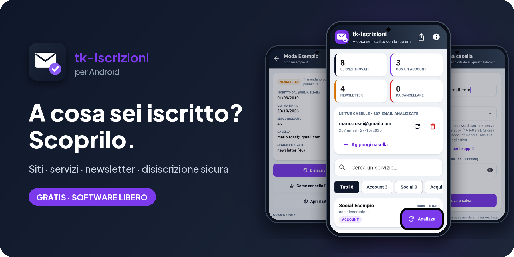
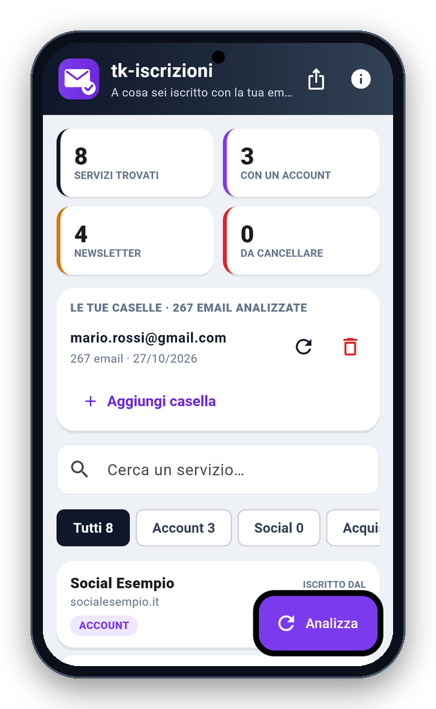
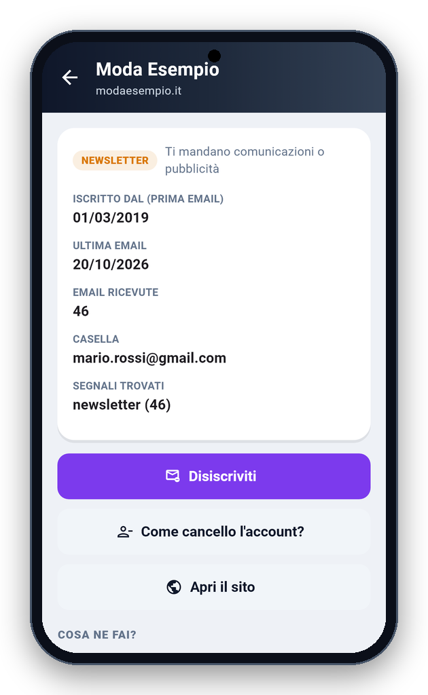
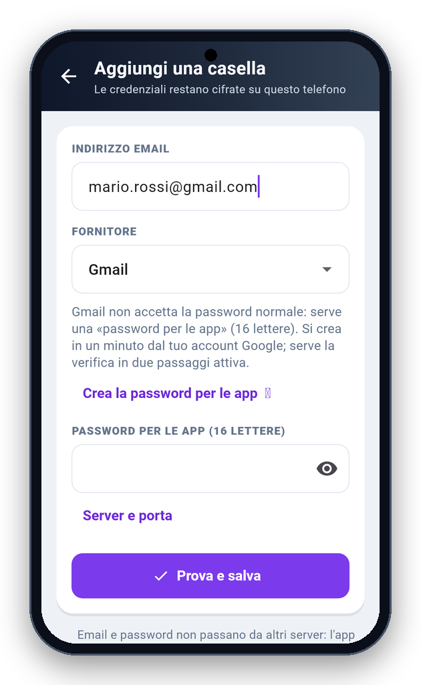

<!-- README generato da Dropbox/CLAUDE/dev/agpl-rollout/readme/genera_readme_app.py: modificare lì -->
<div align="center">



<br><br>

<a href="https://pietrodefilippis.it/scarica-app/tk-iscrizioni-app/"></a> &nbsp; <a href="https://pietrodefilippis.it/donazione/"></a>

<br><br>

<a href="COPYING"></a>   

</div>

---

## ✨ Cosa fa

<table>
<tr>
<td width="50%" valign="top">

### 📬&nbsp; La tua casella
L'app legge solo le intestazioni delle email (mittente, oggetto, data), in sola lettura.

</td>
<td width="50%" valign="top">

### 🧭&nbsp; Servizi trovati
Divisi per tipo: account, social, acquisti, newsletter.

</td>
</tr>
<tr>
<td width="50%" valign="top">

### 📅&nbsp; Da quando
Per ogni servizio vedi da quando sei iscritto.

</td>
<td width="50%" valign="top">

### 🚪&nbsp; Disiscriviti
Esci dalle newsletter e dai servizi che non vuoi più.

</td>
</tr>
<tr>
<td width="50%" valign="top">

### ✅&nbsp; Solo email autentiche
Il link di disiscrizione si usa solo se l'email ha la firma DKIM verificata del mittente.

</td>
<td width="50%" valign="top">

### 👀&nbsp; Niente sorprese
Prima di aprire un link l'app ti mostra dove porta.

</td>
</tr>
</table>

## 📱 Com'è fatta

<div align="center">

<table align="center">
<tr>
<td align="center" valign="top"><br><sub><b>Servizi</b></sub></td>
<td align="center" valign="top"><br><sub><b>Servizio</b></sub></td>
<td align="center" valign="top"><br><sub><b>Aggiungi casella</b></sub></td>
</tr>
</table>

</div>

## 🔒 I tuoi dati

- **Privacy:** l'archivio delle intestazioni e le password delle caselle (nella cassaforte del telefono) restano sul telefono. In rete: il tuo fornitore di posta; Dropbox per il controllo degli aggiornamenti (Android); i siti dei mittenti solo quando premi «Disiscriviti». Le statistiche anonime (una volta al giorno: nome, versione, sistema e un codice casuale) partono solo se dici sì nel benvenuto o in Informazioni.
- **Disiscrizione sicura:** il link di disiscrizione si usa solo se l'email ha la firma DKIM verificata del mittente; prima di aprirlo l'app mostra dove porta, e la richiesta in un clic va solo in https verso siti pubblici.

Nessuna pubblicità, nessun account da creare, nessun abbonamento: tutte le funzioni sono gratis, per tutti.

## 📥 Installazione

- **Android** — [scarica l'app](https://pietrodefilippis.it/scarica-app/tk-iscrizioni-app/) da pietrodefilippis.it e aprila: Android chiede una volta il permesso di installare app da questa origine. Gli aggiornamenti arrivano da soli, l'app te li propone. A breve anche su Google Play.
- **Piattaforme:** Android e iPhone. C'è anche per Windows e Mac: [tk-iscrizioni per computer](https://pietrodefilippis.it/software/).

<details>
<summary><b>🛠️ Compilare dal codice sorgente</b></summary>

<br>

Serve [Flutter](https://flutter.dev) (versione indicata in `.github/workflows/android.yml`):

```bash
flutter pub get
flutter test
flutter build apk --release
```

Senza la variabile `ANDROID_KEYSTORE` l'APK si firma con la chiave di debug di Flutter.

</details>

## 📜 Licenza

**tk-iscrizioni** è software libero: © 2026 Pietro De Filippis (TecnikGeek), licenza
**[GNU Affero General Public License v3.0](COPYING)**. Puoi usarlo, studiarlo, modificarlo e condividerlo; è
fornito **così com'è, senza alcuna garanzia**.

> Il nome **tk-iscrizioni** e il logo non sono coperti dalla licenza (AGPL, sezione 7): una versione modificata deve avere un nome diverso.

---

<div align="center">

**Ti è utile?** Tutte le funzioni sono gratis per tutti. Se vuoi, un caffè aiuta a migliorarla e a crearne altre.

<a href="https://pietrodefilippis.it/donazione/"></a>

<sub>Creata da <a href="https://pietrodefilippis.it">Pietro De Filippis · TecnikGeek</a> — Webmaster & UX/UI Designer</sub>

</div>
